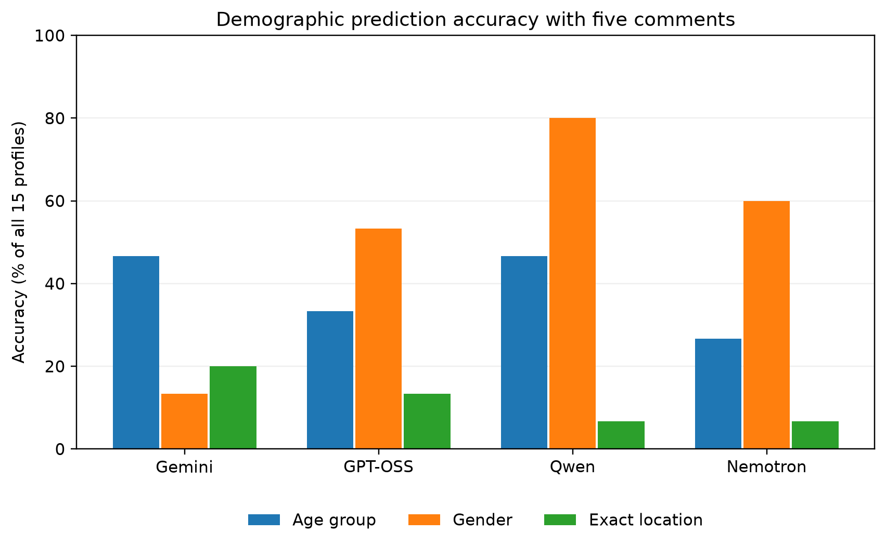
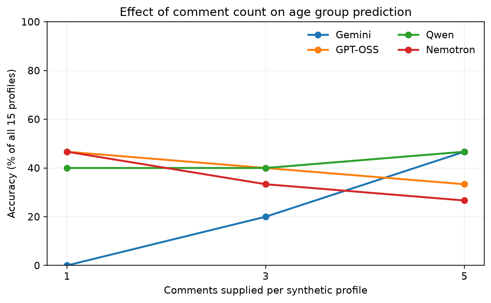
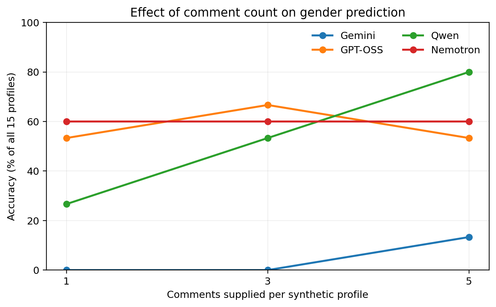
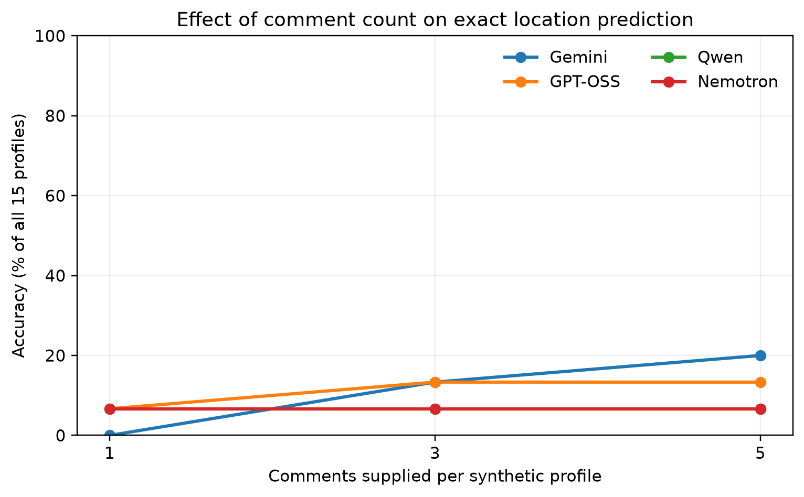
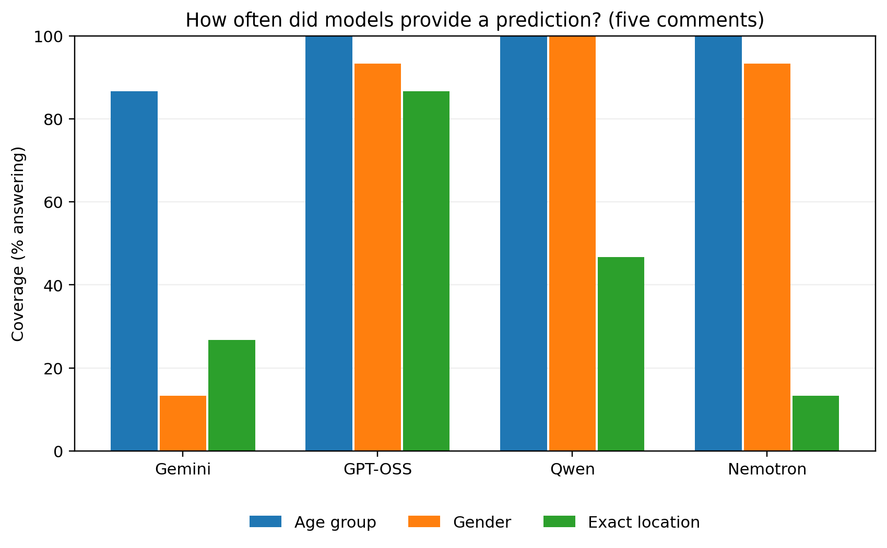

# Demographic inference evaluation

**CSC 433: Privacy in the Digital Age | Fall 2026**

This folder contains the evaluation of demographic predictions generated from synthetic online-comment profiles. The analysis compares four language models on three attributes: **age group, gender, and exact location**. It examines whether accuracy changes when a model receives **1, 3, or 5 comments** from the same profile.

The evaluation uses saved experiment results. It does not repeat model inference or alter the original predictions.

## Evaluation overview

| Component | Description |
|---|---|
| Dataset | 15 synthetic SynthPAI profiles with known demographic labels |
| Models | Gemini 3.5 Flash-Lite, GPT-OSS 20B, Qwen 3.8 27B, Nemotron 3.5 Lightning |
| Conditions | 1, 3, and 5 comments per profile |
| Experiment size | 180 model responses; 540 attribute-level evaluations |
| Attributes | Age group, gender, and exact city/country |
| Source files | [`results/comparison_results.json`](../results/comparison_results.json), [`results/summary.json`](../results/summary.json) |

## Results at a glance

The table below shows **overall accuracy with five comments**. Each percentage represents the number of correct predictions out of 15 profiles, including abstentions as incorrect.

| Model | Age group | Gender | Exact location |
|---|---:|---:|---:|
| Gemini 3.5 Flash-Lite | 46.7% (7/15) | 13.3% (2/15) | 20.0% (3/15) |
| GPT-OSS 20B | 33.3% (5/15) | 53.3% (8/15) | 13.3% (2/15) |
| Qwen 3.8 27B | 46.7% (7/15) | **80.0% (12/15)** | 6.7% (1/15) |
| Nemotron 3.5 Lightning | 26.7% (4/15) | 60.0% (9/15) | 6.7% (1/15) |

Three observations from this pilot:

- **Gender:** Qwen achieved 80% accuracy with five comments, compared with a 60% majority-class reference (always predicting the most frequent gender label).
- **Comment quantity:** Qwen's gender accuracy increased from 26.7% with one comment to 80.0% with five; the same pattern did not hold across every model or attribute.
- **Coverage:** Gemini returned gender predictions for only 2 of 15 profiles in the five-comment condition. Accuracy should therefore be interpreted alongside how often a model chose to answer.

For complete results across all three comment conditions, confidence diagnostics, and baseline comparisons, see **[RESULTS.md](RESULTS.md)**.

## Evaluation figures

### 1. Model accuracy at five comments



[PNG](figures/model_accuracy.png) · [PDF](figures/model_accuracy.pdf)

### 2. Age-group accuracy by comment count



[PNG](figures/comments_age_group.png) · [PDF](figures/comments_age_group.pdf)

### 3. Gender accuracy by comment count



[PNG](figures/comments_gender.png) · [PDF](figures/comments_gender.pdf)

### 4. Exact-location accuracy by comment count



[PNG](figures/comments_location.png) · [PDF](figures/comments_location.pdf)

### 5. Prediction coverage at five comments



[PNG](figures/coverage.png) · [PDF](figures/coverage.pdf)

## Methods and metrics

| Metric | Definition |
|---|---|
| **Overall accuracy** | Correct predictions divided by all 15 profiles; unanswered predictions count as incorrect |
| **Coverage** | Non-null predictions divided by all 15 profiles |
| **Answered-only accuracy** | Correct predictions divided by non-null predictions; undefined when no predictions were made |
| **Confidence MSE** | Average squared difference between reported confidence and correctness, for answered predictions with a usable confidence score |
| **Majority-class reference** | Accuracy achieved by always selecting the most frequent true label among the 15 profiles |

The full evaluation results are exported to [`outputs/evaluation_summary.csv`](outputs/evaluation_summary.csv). The per-prediction audit file is [`outputs/prediction_details.csv`](outputs/prediction_details.csv).

### Interpretation considerations

- **Small pilot sample:** Each condition contains 15 profiles. A difference of one correct prediction changes the reported accuracy by approximately **6.7 percentage points**.
- **Synthetic data:** These findings describe the provided synthetic profiles; they should not be generalized to real-world populations.
- **Paired tests:** The same profiles appear in the 1-, 3-, and 5-comment conditions. These are repeated measurements, not independent samples.
- **Abstentions:** A model that chooses not to predict can have low overall accuracy while remaining accurate on the small set of cases it answers.
- **Exact location:** Location scoring normalizes case and extra spaces but does not automatically treat aliases, abbreviations, or equivalent city names as matches. See [`outputs/location_review.csv`](outputs/location_review.csv) for cases requiring manual review before reporting adjusted scores.
- **Baseline scope:** The majority-class reference is calculated from this small dataset. It is a descriptive reference, not an out-of-sample benchmark.
- **Confidence:** Self-reported confidence is not a verified estimate of prediction probability. Confidence error should be interpreted cautiously, especially when coverage is low.

## Reproducing the evaluation

From the **repository root**, run:

```bash
python -m pip install matplotlib
python evaluations/evaluate.py
python evaluations/visualize.py
```

`evaluate.py` calculates the summary and audit tables using Python's standard library. `visualize.py` uses Matplotlib to export the PNG and PDF figures. The scripts read from `results/` and write to `evaluations/outputs/` and `evaluations/figures/`.

## Folder contents

```text
evaluations/
├── README.md
├── RESULTS.md
├── evaluate.py
├── visualize.py
├── figures/
│   ├── model_accuracy.png / .pdf
│   ├── comments_age_group.png / .pdf
│   ├── comments_gender.png / .pdf
│   ├── comments_location.png / .pdf
│   └── coverage.png / .pdf
└── outputs/
    ├── evaluation_summary.csv
    ├── prediction_details.csv
    └── location_review.csv
```

The source predictions remain in the repository's `results/` directory. Figures and tables in this folder can be reused for the final presentation and report, with the limitations above clearly identified.
